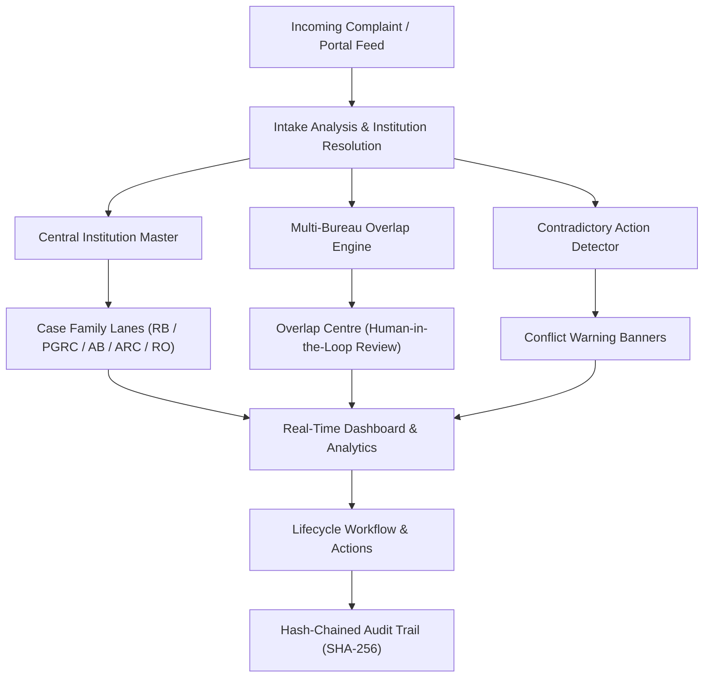
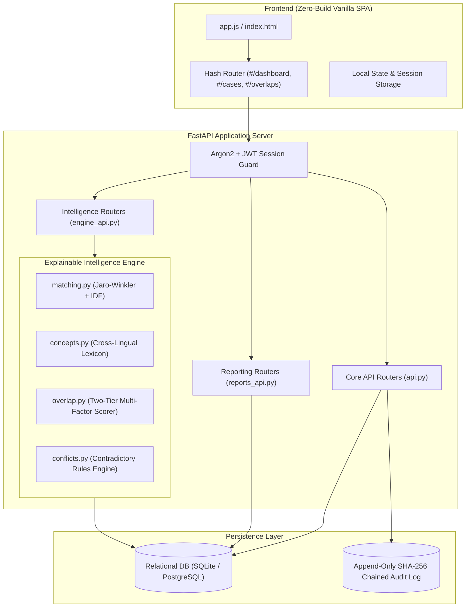
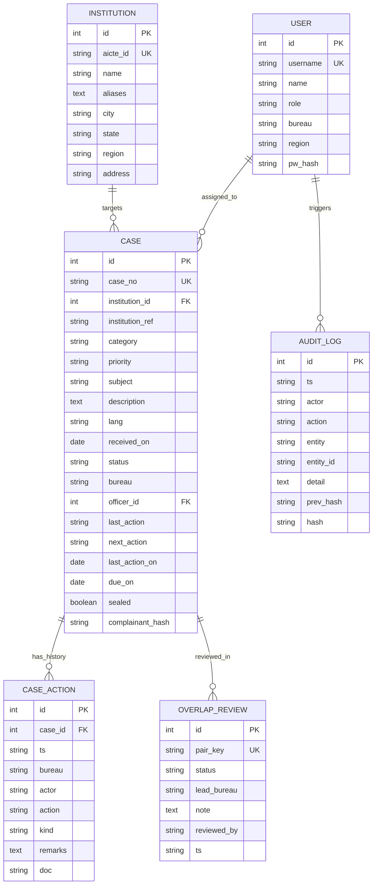
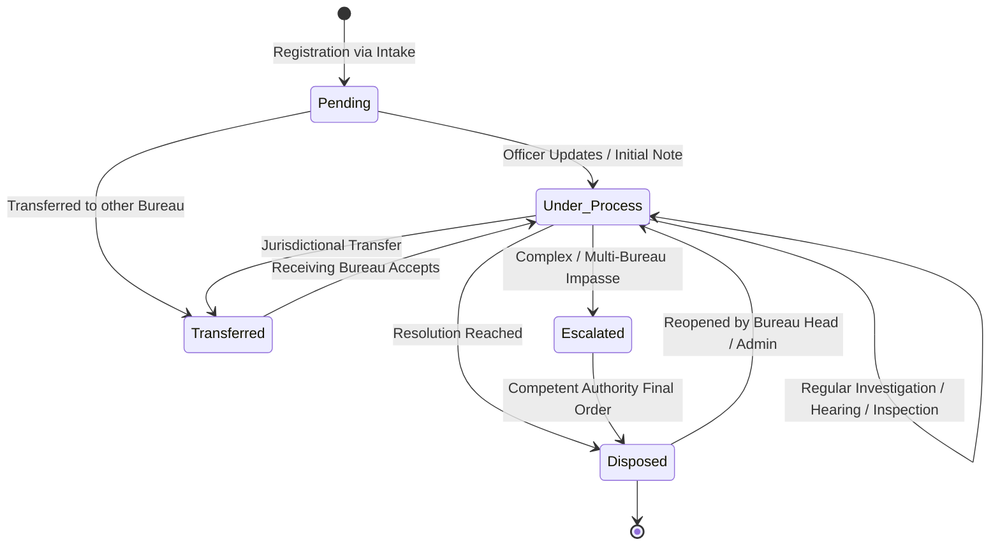
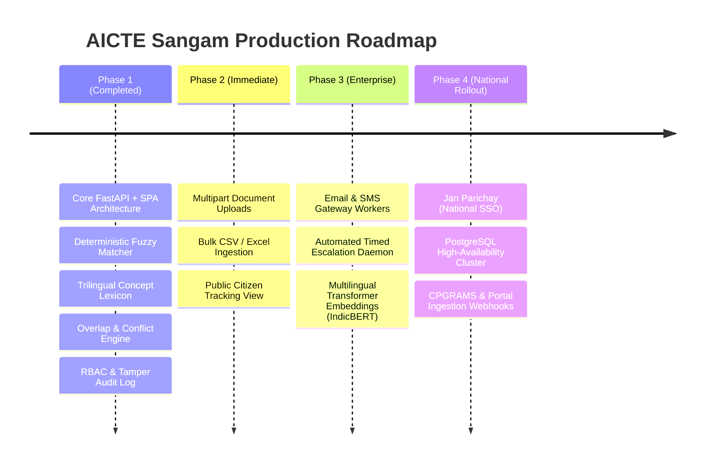

# AICTE Sangam — Master Project Blueprint & Specification
**SIH Problem Statement ID 26264 · AICTE · Regulation Bureau · Smart Automation**

---

## 1. Executive Summary & Problem Context

### 1.1 Problem Statement Details
* **Problem Statement ID:** 26264
* **Title:** Integrated Dashboard for Monitoring and Tracking Institution-Related Complaint Cases Across AICTE Bureaus/Cells
* **Organization:** All India Council for Technical Education (AICTE)
* **Department:** Regulation Bureau (RB)
* **Category:** Software
* **Theme:** Smart Automation

### 1.2 The Core Operational Challenge
The All India Council for Technical Education (AICTE) receives thousands of grievances and complaints from students, parents, faculty members, and institutional stakeholders across India. These cases are processed by multiple autonomous Bureaus and Cells:
* **Regulation Bureau (RB):** Handles violations of AICTE Approval Process Handbook (APH) regulations, faculty cadre ratios, unapproved courses/intake, and infrastructural deficiencies.
* **Public Grievance Redressal Cell (PGRC):** Handles individual grievances regarding fee refunds, withheld original certificates, delayed faculty salaries, and administrative harassment.
* **Approval Bureau (AB):** Oversees formal extension of approvals, progressive closure, and sanctioned intake limits.
* **Anti-Ragging Cell (ARC):** Handles critical, time-sensitive student safety and ragging incidents.
* **Regional Offices (ROs):** Northern, Western, Eastern, Southern, Central, and North-Eastern territorial offices.

**The Failure Mode:**
Currently, complaints concerning the **same technical institution** arrive at different Bureaus at different times, often phrased in completely different language:
* A student submits an urgent Hinglish grievance to PGRC: *"College security deposit aur marksheet wapas nahi kar raha hai"*.
* Meanwhile, an inspection report or faculty complaint arrives at RB: *"Non-compliance with AICTE cadre norms and irregular administrative practices"*.

Without a centralized, real-time mechanism:
1. **Parallel Actions:** RB and PGRC investigate the same institution independently without mutual awareness.
2. **Duplication of Effort:** Multiple show-cause notices and inspection panels are ordered simultaneously.
3. **Contradictory Regulatory Orders:** One Bureau may close a grievance finding compliance, while another Bureau cancels approval or issues a penalty notice.
4. **SLA Breaches & Inactivity:** Cases languish without cross-departmental accountability.

### 1.3 The Solution: AICTE Sangam
**AICTE Sangam** is an intelligent, single-window complaint monitoring dashboard that establishes a single source of truth across all AICTE bodies. It continuously correlates complaints, resolves messy institutional references, calculates cross-bureau overlap risk, raises warnings *before* conflicting orders are issued, and provides end-to-end lifecycle tracking with a tamper-evident audit trail.

---

## 2. Complete Functional Requirements Specification (FRS)



### Pillar 1: Centralized Institution Profile
* **Permanent AICTE ID Integration:** Every institution is anchored by its unique AICTE Permanent ID (e.g., `1-456789123`).
* **Institution Master Directory:** Canonical name, approved address, city, state, region, and official contact details.
* **Aliases & Acronym Lexicon:** Maintains former names, vernacular abbreviations, and acronyms (e.g., *"CoEP"*, *"College of Engg Pune"*, *"COEP Tech University"*).
* **Consolidated Cross-Bureau Case Family:** A single screen showing every past and current case across all Bureaus grouped into dedicated visual lanes.

### Pillar 2: Complaint/Case Tracking & Metadata
Every registered case captures an exhaustive set of metadata:
* **Unique Case Number:** Formatted systematically as `AICTE/{BUREAU}/{YEAR}/{SEQUENCE}`.
* **Receipt Date & Source:** ISO date of registration and origin.
* **Nature / Category:** Standardized taxonomy (Faculty Norms, Salary Delay, Fee Refund, Withheld Certificates, Unapproved Intake, Infrastructure Deficiency, Ragging).
* **Status Lifecycle:** `Pending` $\rightarrow$ `Under Process` $\rightarrow$ `Transferred` $\rightarrow$ `Escalated` $\rightarrow$ `Disposed`.
* **Assigned Bureau & Official:** Dynamically routed to the least-loaded officer within the responsible cell.
* **Last & Next Action Trail:** Concrete record of the last action taken, date of action, and explicit next milestone required.
* **SLA & Due Date Calculation:** Automatically calculated expected disposal date based on category-specific AICTE norms.

### Pillar 3: Cross-Bureau Overlap Detection & Linking
* **Automated Pairwise Detection:** Scans all active cases across all Bureaus for common institutional targets.
* **Explainable Two-Tier Scoring:**
  * *Tier A (System-Wide Rule):* Flag when $\ge 2$ Bureaus have open cases against one institution.
  * *Tier B (Multi-Factor Formula):* Evaluates semantic text similarity, category correlation, temporal proximity, complainant hash, and financial amounts.
* **Interactive Overlap Centre:** Side-by-side comparison of competing cases with clear natural-language explanations of *why* they were flagged.
* **Human-in-the-Loop Coordination:** Officers can designate a **Lead Bureau**, record joint coordination directives into both case histories, or dismiss false positives as "Not Related".

### Pillar 4: Real-Time Monitoring Dashboard
* **Macro KPI Cards:** Real-time counts of Total, Pending, Under Process, Transferred, Escalated, Disposed, Beyond Timeline (Overdue), and Due in 7 Days.
* **Emergency Alert Banner:** High-visibility banner when uncoordinated cross-bureau overlaps or conflicting orders exist.
* **Bureau Workload Gauges:** Active vs. Overdue breakdown across RB, PGRC, AB, ARC, and RO.
* **Pending Case Ageing Analysis:** Stratified brackets: `0–15 days`, `16–30 days`, `31–60 days`, and `60+ days`.
* **Monthly Inflow Trend:** Visual inflow SVG chart showing complaint volume trends over the past 8 months.
* **Top Institutions at Risk:** Ranked bar chart of institutions with the highest concentration of active complaints.
* **Impact Estimator:** Live calculation of duplicate work prevented and estimated officer-hours saved.

### Pillar 5: Chronological Workflow & Action History
* **Immutable Timeline:** Every action records timestamp, responsible bureau, officer username, action type, and remarks.
* **Semantic Action Kinds:** Tags actions as `note`, `show_cause`, `inspection`, `reply_received`, `hearing`, `approval_withdrawn`, `compliance_found`, `closure`, `refund_ordered`, or `penalty`.
* **Inter-Bureau Transfers:** Formal transfer protocol requiring explicit acceptance by the target Bureau.
* **Escalation Protocol:** Immediate elevation to Competent Authority for stalled or contentious matters.

### Pillar 6: Search & Filter Palette
* **Global Command Palette (<kbd>Ctrl</kbd> + <kbd>K</kbd>):** Instant fuzzy search across cases, institutions, and administrative routes.
* **Multi-Parametric Case Filters:** Filter by keyword, Bureau, Region, Category, Status, Overdue flag, and Custom Date Ranges (`From` / `To`).

### Pillar 7: Alerts & Notification Engine
* **Breached SLA Alerts (High Severity):** Instant flagging of any active case surpassing its prescribed disposal date.
* **Approaching Timeline Alerts (Medium Severity):** Proactive warning for cases due within 7 days.
* **Idle Case Reminders (Low Severity):** Notification when an active case has had no recorded action for $\ge 10$ days.
* **Overlap & Conflict Warnings:** Immediate high-priority alerts to heads of involved Bureaus.
* **Personalized "My Cases" Scope:** One-click filter allowing officers to isolate their direct responsibilities.

### Pillar 8: Reports & Export Analytics
* **8 Standard Report Views:** Bureau-wise, Region-wise, Institution-wise, Category-wise, Status-wise, Ageing, Monthly/Quarterly performance, and Overlaps.
* **Universal CSV Export:** Excel-compatible UTF-8 BOM CSV export for all reporting dimensions.
* **Print-to-PDF Formatting:** Tailored print stylesheets for executive briefings and physical distribution.

### Pillar 9: Innovation Requirement (Cross-Lingual Matching & Conflict Detection)
* **Messy Institution Resolution:** Robust identification despite spelling errors, dropped words, or colloquial abbreviations (e.g. *"Aryabht Inst of Eng"* $\rightarrow$ *"Aryabhatta Institute of Engineering and Technology"*).
* **Trilingual Cross-Lingual Lexicon:** Bridges English, Hinglish, and Devanagari Hindi so semantically identical complaints in different tongues correlate instantly.
* **Contradictory Regulatory Action Detection:** Specialized rule engine that intercepts conflicting institutional orders across Bureaus (e.g. Withdrawal of Approval vs. Finding of Compliance) before regulatory embarrassment occurs.

### Pillar 10: Security, Privacy & Tamper-Evident Governance
* **Server-Side Role-Based Access Control (RBAC):** Strict policy enforcement at the API layer.
* **Regional Data Isolation:** Regional officers only see data within their designated geographical jurisdiction.
* **Need-to-Know Sealed Cases:** Ragging and sensitive harassment complaints are sealed by default; every view is audited.
* **Complainant PII Protection:** Phone numbers and email addresses are never stored in raw plaintext; only salted cryptographic hashes are retained for duplicate detection.
* **Cryptographic Hash-Chained Audit Trail:** Every database modification commits to the previous row's SHA-256 hash, making unauthorized edits or deletions instantly detectable.

---

## 3. User Roles & Permission Matrix (RBAC)

The system defines 4 primary administrative tiers across 5 Bureau scopes:

| Capability | ADMIN (Chairman / MS) | HEAD (Bureau Head) | OFFICER (Case Officer) | REGIONAL (Regional Officer) |
|---|:---:|:---:|:---:|:---:|
| **Dashboard & Global KPIs** | All Bureaus | All Bureaus | All Bureaus | Own Region Only |
| **View Cases** | All Cases | All Cases | All Cases | Own Region Only |
| **View Sealed Cases (Ragging)** | Yes (Audited) | Own Bureau Only | Own Bureau Only | No |
| **Create New Complaint** | Yes | Yes | Yes | Yes |
| **Take Case Action (Update/Note)** | Any Case | Own Bureau Cases | Assigned Cases | Own Region (RO cases) |
| **Transfer Case to another Bureau** | Yes | Yes | Yes | Yes |
| **Accept Transferred Case** | Yes | Own Bureau | Own Bureau | Own Region |
| **Escalate to Competent Authority** | Yes | Yes | Yes | Yes |
| **Dispose Standard Case** | Yes | Yes | Yes | Yes |
| **Dispose Escalated Case** | **Yes (Exclusive)** | No | No | No |
| **Reopen Disposed Case** | Yes | Yes | No | No |
| **Review Overlaps & Designate Lead** | Yes | Yes | Yes | No (Read-Only) |
| **Verify Audit Chain & Security Logs** | **Yes (Exclusive)** | No | No | No |
| **View Benchmark & Evaluation Engine** | Yes | Yes | No | No |

---

## 4. End-to-End System Architecture



### 4.1 Database Entity-Relationship Model (ERD)



### 4.2 State Machine: Case Lifecycle & Coordination



---

## 5. Algorithmic Intelligence Formulation

### 5.1 Institution Entity Resolution (`engine/matching.py`)
Incoming complaints rarely quote clean AICTE IDs. They provide misspelled, partial, or acronym-based names.

1. **AICTE ID Fast Path:** Extracts digit clusters $\ge 9$ digits. If it matches `Institution.aicte_id`, score is $1.0$ (`auto` band).
2. **Text Normalization:** Lowercases, normalizes ampersands, strips generic stop-words (`of`, `and`, `the`, `in`), and expands standard abbreviations (`engg` $\rightarrow$ `engineering`, `instt` $\rightarrow$ `institute`, `clg` $\rightarrow$ `college`).
3. **Soft IDF Jaro-Winkler Matching:**
   For a query token set $Q$ and candidate variant token set $V$, the match score is:
   $$\text{Score}(Q, V) = \frac{\sum_{q \in Q} \text{IDF}(q) \cdot \max_{v \in V} \big(\mathbb{I}_{JW(q,v) \ge 0.88} \cdot JW(q, v)\big)}{\sum_{q \in Q} \text{IDF}(q)}$$
   where $JW(q, v)$ is the Jaro-Winkler string similarity and $\text{IDF}(t) = \ln\left(\frac{N + 1}{\text{DF}(t) + 1}\right) + 1$.
4. **Decision Bands:**
   * **Score $\ge 0.85$:** `auto` — High-confidence auto-linking.
   * **$0.55 \le \text{Score} < 0.85$:** `review` — Top 3 suggestions surfaced to officer for confirmation.
   * **Score $< 0.55$:** `none` — Flagged as unresolved; officer manually searches directory.

### 5.2 Trilingual Cross-Lingual Concept Lexicon (`engine/concepts.py`)
To match across languages without dependency on external paid LLMs or external translation services:
* **Canonical Concept Mapping:** Surface forms across English, Hinglish, and Hindi map to shared tokens:
  * `{refund, refunds, wapas, वापस, repay, लौटा}` $\rightarrow$ `refund`
  * `{fee, fees, शुल्क, फीस, charges}` $\rightarrow$ `fee`
  * `{salary, remuneration, wages, वेतन, तनख्वाह}` $\rightarrow$ `salary`
  * `{withhold, holding, rok, रोककर, रोक, retain}` $\rightarrow$ `withhold`
  * `{ragging, harassing, pareshan, परेशान, torture}` $\rightarrow$ `ragging`
* **Cosine Similarity:** Computes vector cosine similarity over concept frequency distributions between complaints.

### 5.3 Overlap Detection Formula (`engine/overlap.py`)
For any two active cases $A$ and $B$ linked to the same institution:
$$S(A, B) = w_{\text{text}} \cdot S_{\text{text}} + w_{\text{cat}} \cdot S_{\text{cat}} + w_{\text{time}} \cdot S_{\text{time}} + w_{\text{comp}} \cdot S_{\text{comp}} + w_{\text{amt}} \cdot S_{\text{amt}}$$

Where:
* $w_{\text{text}} = 0.45$: Cosine concept similarity between subjects and descriptions.
* $w_{\text{cat}} = 0.25$: Category match ($1.0$ if identical; $0.5$ if related like `faculty_norms` and `salary_delay`; else $0.0$).
* $w_{\text{time}} = 0.12$: Gated temporal decay $2^{-\Delta\text{days} / 60} \cdot \min(1.0, S_{\text{text}} / 0.30)$.
* $w_{\text{comp}} = 0.10$: $1.0$ if complainant contact hash matches, else $0.0$.
* $w_{\text{amt}} = 0.08$: $1.0$ if identical financial figures ($\ge 4$ digits) are quoted in both matters.
* **Unrelated Subject Suppression:** If $S_{\text{cat}} = 0$ and $S_{\text{text}} < 0.20$ without complainant match, score is hard-capped at $0.30$ to prevent false alarms on different issues at the same large campus.
* **Severity Tiers:** $\text{Score} \ge 0.60$ (`High`), $0.40 \le \text{Score} < 0.60$ (`Medium`).

### 5.4 Contradictory Action Interceptor (`engine/conflicts.py`)
Scans action histories of related cases at the same institution handled by differing Bureaus:

| Bureau A Action | Bureau B Action | Severity | System Warning Message |
|---|---|:---:|---|
| `approval_withdrawn` | `compliance_found` | **High** | *"One Bureau withdrew approval while another found the institution compliant. Coordination required before further action."* |
| `penalty` | `compliance_found` | **High** | *"A penalty is being imposed while another Bureau found the institution compliant. Coordination required."* |
| `approval_withdrawn` | `closure` | **Medium** | *"Approval withdrawn by one Bureau while another closed a related case."* |
| `show_cause` | `closure` | **Medium** | *"Show-cause issued by one Bureau on a matter another Bureau has closed."* |

---

## 6. Complete API Endpoint Specification

### Authentication & Meta
* `POST /api/auth/login` — Authenticate user via username + password; rate-limited (5 fails / 5 min); sets HTTP-only `session` JWT cookie.
* `POST /api/auth/logout` — Clears session cookie and invalidates client session.
* `GET /api/auth/me` — Returns current logged-in identity, role, bureau, and region.
* `GET /api/meta` — Returns global domain configuration: bureaus, regions, statuses, categories, action kinds.
* `GET /api/health` — Liveness and system health probe.

### Case Management
* `GET /api/cases` — Filtered, paginated list of cases. Scoped by user role/region. Supports full-text search, bureau, category, status, overdue, and date bounds.
* `GET /api/cases/{id}` — Full case detail with chronological timeline and permissions check. Logs views if case is sealed.
* `POST /api/cases` — Register new complaint. Calculates SLA due date; hashes complainant PII; assigns least-loaded officer.
* `POST /api/cases/{id}/actions` — Append workflow action (`update`, `accept`, `transfer`, `escalate`, `dispose`, `reopen`).

### Institution Intelligence
* `GET /api/institutions` — Institution directory with count of active cases per institution.
* `GET /api/institutions/{id}` — Institution profile with multi-bureau case family lanes.
* `GET /api/institutions/resolve/match?q={query}` — On-the-fly resolution of messy institutional query text.

### Intelligence & Coordination
* `GET /api/overlaps` — System-wide list of active overlapping cases grouped by institution.
* `GET /api/conflicts` — List of contradictory action warnings across Bureaus.
* `GET /api/cases/{id}/overlaps` — Specific overlap and conflict alerts for a single case.
* `POST /api/intake/analyze` — Pre-registration analysis: resolves institution, suggests category/bureau, surfaces similar active cases before registration.
* `POST /api/overlaps/review` — Human decision: `acknowledge`, `designate_lead`, or `not_related`. Appends record to both cases.

### Reports, Alerts & Security
* `GET /api/alerts` — Real-time high/medium/low alerts (SLA breach, approaching due date, idle reminders, overlaps). Supports `?mine=true`.
* `GET /api/reports/{kind}` — Aggregated reporting engine (`bureau`, `region`, `institution`, `category`, `status`, `ageing`, `monthly`, `quarterly`, `overlaps`). Supports `?format=csv`.
* `GET /api/impact` — Dynamic metric calculating cross-bureau pairs caught and estimated officer-hours saved.
* `GET /api/audit` — Append-only audit trail (Admin only).
* `GET /api/audit/verify` — Validates cryptographic SHA-256 hash integrity across the entire database history.
* `GET /api/evaluation` — Regression evaluation of matching engine against ground-truth benchmark.

---

## 7. Gap Analysis & Production Readiness Roadmap

To transition this hackathon-winning prototype into an institutional-grade national deployment across AICTE Headquarters and all Regional Centres, the following 6 enhancements are outlined:



### Detailed Gap Matrix

| Production Dimension | Current Status | Required Production Implementation |
|---|---|---|
| **1. Document Storage** | **Completed & Active** | Supported via `POST /api/cases/{id}/documents` with secure file storage, validation, download endpoint, and in-timeline viewer. |
| **2. Batch / Legacy Import** | **Completed & Active** | Implemented at `#/import` with CSV template download, fuzzy institution matching preview, overlap warnings, and batch commit. |
| **3. Complainant Portal** | **Completed & Active** | Implemented public tracker at `#/track` with milestone progress stepper, SLA timeline, and PII privacy protection without login. |
| **4. Active Dispatch** | Alerts exist in UI dashboard and banners. | Integrate Celery / APScheduler with NIC SMS Gateway and SMTP email for immediate push notifications to assigned officers. |
| **5. AI Embeddings** | Handcrafted 7-theme lexicon (covers English, Hinglish, Hindi). | Add a fallback vector search pipeline (using sentence-transformers or Gemini API embeddings) for complex narrative complaints. |
| **6. Enterprise SSO** | Custom Argon2 password auth with role scoping. | Integrate National Single Sign-On (Jan Parichay / Parichay e-Pramaan) for government employee authentication. |

---

## 8. Verification & Demonstration Playbook

### 8.1 Automated Test Suite Verification
The codebase includes 19 integration tests verifying every PS requirement:
```bash
cd backend
python -m pytest -q
```
* **Authentication & Throttling:** Verifies 401 on unauthenticated access and 429 lockout after 5 consecutive bad passwords.
* **RBAC & Regional Isolation:** Verifies RB officers cannot modify PGRC cases and Regional officers only see their region.
* **Need-to-Know Privacy:** Verifies sealed ragging cases are completely invisible to unauthorized users.
* **Tamper-Evident Audit Chain:** Artificially modifies a historical database row and verifies that `verify_chain()` immediately catches the corruption.
* **Cross-Lingual Engine:** Validates that English, Hinglish, and Hindi fee-refund complaints yield cosine similarity $> 0.4$, while ragging yields $0.0$.
* **Conflict Interception:** Proves all 4 planted conflicting actions are captured.
* **Public Citizen Tracking:** Verifies unauthenticated tracking returns milestones while safeguarding sealed records.
* **Document Upload & Retrieval:** Verifies file attachments on cases, download integrity, and path traversal protection.
* **Bulk Ingestion Pipeline:** Verifies CSV template generation, fuzzy institution matching preview, and batch commit.

### 8.2 The 5-Minute Evaluator Demonstration Flow
When presenting to evaluators, follow this exact sequence:

1. **Dashboard Overview (`#/dashboard` as `chairman`):**
   * Highlight the red warning banner: *"Potential Overlapping Cases — Coordination Required"*.
   * Point out the **Impact Estimate** card: Live counts of duplicate pairs intercepted and officer-hours saved.
2. **Overlap Centre (`#/overlaps`):**
   * Expand a **High Severity** pair: Show PGRC case (student voice in informal Hinglish) side-by-side with an RB case (formal English).
   * Show the plain-language justification generated by the engine.
3. **Conflicting Regulatory Actions (`#/overlaps`):**
   * Point out: *"RB withdrew approval while PGRC found compliance"*. Emphasize how this avoids severe legal and regulatory embarrassment for AICTE.
4. **Live Intake Pre-check (`#/new`):**
   * Click **▶ Fill demo complaint**.
   * Watch the system auto-resolve a misspelled institution name, detect category and bureau from Hinglish text, and surface existing active cases *before* submission.
5. **Human-in-the-Loop Coordination:**
   * Click **Make lead: RB**. Show that the decision is immediately committed into both case histories and the hash-chained audit log. Nothing is blindly auto-merged.
6. **Reports & Audit Verification (`#/audit`):**
   * Show one-click CSV export and PDF-ready reports.
   * Open the Audit Trail to display the green *"✓ Hash chain intact"* badge verifying data integrity.
